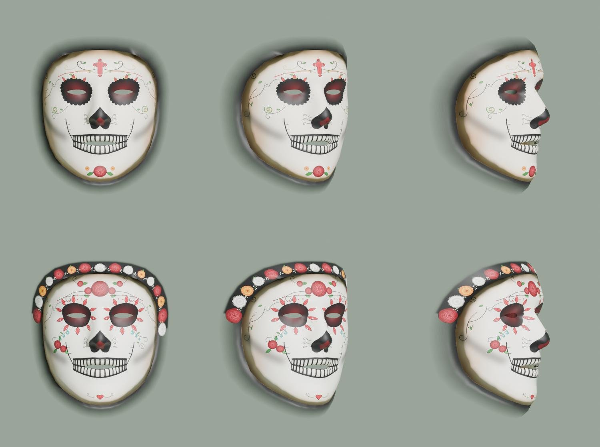

# Máscara de Día de Muertos · Filtro facial de RA

Filtro de realidad aumentada para web: al abrir la página se enciende la cámara frontal, se detecta el rostro y se le pone encima una máscara de calavera de Día de Muertos **mapeada a la malla facial**. La máscara se ajusta a ojos, nariz, boca y contorno, se deforma con los gestos y se queda puesta al girar la cabeza.

Actividad 3 · Máscara de Día de Muertos con mapeo facial de precisión (mejora de la [Actividad 2](https://github.com/flamaBarrita/RA-2)).



Hay dos máscaras: **catrín** (`assets/mascara/textura_catrin.png`) y **catrina** (`assets/mascara/textura_catrina.png`). El filtro carga `assets/mascara/textura.png`, que es la catrina. Se generan con `tools/generar_texturas_catrines.py` siguiendo el diseño de [docs/DISENO_CATRINES.md](docs/DISENO_CATRINES.md), y se pueden retocar a mano en Blender con [docs/GUIA_TEXTURA.md](docs/GUIA_TEXTURA.md).

## Gestos

| Gesto | Efecto temático |
| --- | --- |
| 🌼 Abrir la boca | Salen pétalos de cempasúchil de la boca y caen balanceándose; siguen saliendo mientras la boca esté abierta. Suena un soplo con campanitas. |
| 🎊 Levantar las cejas | Cae una lluvia de papel picado de colores sobre la cabeza, con campanas. |
| 🕯️ Parpadear | La máscara cambia de color (hueso → cempasúchil → rosa mexicano → morado → turquesa) y salen chispas de vela de los ojos. |

Los íconos de abajo se iluminan cuando se detecta el gesto. El botón rojo graba un video del filtro (con sonido) y lo descarga, útil para el artículo de LinkedIn. El sonido se activa al tocar la pantalla una vez (los navegadores no permiten audio antes).

## Mejoras frente a la Actividad 2

| | Actividad 2 | Actividad 3 |
| --- | --- | --- |
| Seguimiento | Se suavizaba cada uno de los 468 puntos por separado; al girar rápido la máscara se retrasaba y se "resbalaba". | Se separa la **pose de la cabeza** (posición, giro, tamaño) de la **expresión** y se suavizan por separado (ver abajo). |
| Giros de cabeza | La máscara se quitaba si MediaPipe dudaba unos cuadros. | Umbrales de presencia/seguimiento más bajos (0.35) para no soltar la cara de perfil, y la máscara se **conserva 0.35 s** con la última pose si se pierde la cara. |
| Ojos y boca | Cubiertos por la malla; dependían de la textura. | La malla no tiene triángulos en ojos ni boca interior: **siempre transparentes**, y la boca se abre de verdad. |
| Textura | Sprite sheets animados dibujados en 2D. | Una textura de alta resolución (2048 px) pintada sobre el mapa UV del modelo canónico de MediaPipe, sin costuras (una sola isla UV). |

### Cómo funciona el nuevo seguimiento (`js/seguimiento.js`)

1. **Pose rígida.** En cada cuadro se ajusta la cara canónica de MediaPipe a ~75 puntos que casi no se mueven con los gestos (frente, nariz, pómulos, sienes) con el método de Horn (cuaterniones). Eso da posición, giro y escala de la cabeza.
2. **Expresión.** Los 468 puntos se llevan al sistema de la cara ("cara quieta mirando al frente"). Ahí solo queda la expresión (boca, ojos, cejas).
3. **Suavizado por separado.** La pose usa un filtro *one euro* ágil con una pequeña predicción (16 ms) para seguir giros rápidos sin retraso; la expresión se suaviza más, porque el giro ya no le afecta.
4. **Reconstrucción.** `punto = posición + escala · giro · expresión`, y con eso se arma la malla en Three.js.

Las pruebas (`npm test`) generan caras sintéticas con poses conocidas y comparan contra el método de la Actividad 2:

```
error medio de la nariz en un giro rápido de 60°: Actividad 3 ≈ 2.8 px · Actividad 2 ≈ 5.9 px
temblor con la cara quieta:                       Actividad 3 ≈ 0.15 px · Actividad 2 ≈ 0.19 px
```

## Poner tu máscara

1. Abre `blender/mascara_dia_de_muertos.blend` (o créalo con `tools/preparar_blender.py`).
2. Pinta en el modo **Texture Paint** con la plantilla como guía. Deja **transparentes ojos y boca**.
3. Guarda la imagen y cópiala como **`assets/mascara/textura.png`** (PNG con transparencia, 2048 × 2048).
4. Recarga la página.

La guía completa, con la alternativa de pintar en Krita / Photoshop / Procreate sobre la plantilla, está en [docs/GUIA_TEXTURA.md](docs/GUIA_TEXTURA.md).

En `assets/mascara/mascara.json` se pueden cambiar el nombre de la textura, el brillo, los colores que se alternan al parpadear y sonidos propios por gesto (MP3/WAV en la misma carpeta).

## Probarlo

La cámara solo funciona en `https://` o en `localhost`.

```bash
python3 -m http.server 8000      # y abre http://localhost:8000
npm test                         # pruebas del seguimiento (Node 18+)
```

Para el teléfono hay que publicarlo con https: en Vercel, importa el repositorio (la configuración ya está en `vercel.json` y `build.sh`), o activa GitHub Pages en *Settings → Pages → Deploy from a branch*.

Opciones en la dirección:

- `?debug` muestra los valores de los gestos, el giro de la cabeza en grados, el error del ajuste y los cuadros por segundo. Las teclas 1, 2 y 3 simulan boca, parpadeo y cejas.
- `?limpio` oculta los botones (para grabar).

## Estructura

```
index.html                    página única: abre directo al filtro
css/estilos.css
js/
  main.js                     cámara, detector, escena, bucle y efectos de cada gesto
  seguimiento.js              pose de la cabeza + expresión, filtros one euro (mejora)
  malla-mascara.js            malla de la máscara con el mapa UV del modelo canónico
  gestos.js                   gestos con umbral, histéresis, pausa y línea base
  particulas.js               pétalos, papel picado y chispas
  sonido.js                   sonidos (sintetizados o desde archivo)
  grabador.js                 grabación de video
  datos-cara.js               triángulos, UV y cara de referencia (generado)
assets/mascara/
  mascara.json                configuración de la máscara
  textura.png                 textura que carga el filtro (copia de la catrina)
  textura_catrina.png, textura_catrin.png  las dos máscaras
plantilla/
  plantilla_uv.png            plantilla UV con fondo blanco
  plantilla_uv_transparente.png  la misma plantilla como capa transparente
blender/
  cara_base.obj               malla con UV (la misma que usa el filtro)
  mascara_dia_de_muertos.blend  archivo listo para Texture Paint
  textura.png                 imagen que pinta el .blend (empieza con la catrina)
tools/
  generar_datos_cara.py       genera datos-cara.js, cara_base.obj y las plantillas
  generar_texturas_catrines.py  dibuja las texturas de catrín y catrina
  generar_textura_provisional.py  textura provisional de prueba (primera versión)
  preparar_blender.py         crea el .blend para pintar
pruebas/seguimiento.test.mjs  pruebas del seguimiento
vendor/                       Three.js y MediaPipe (copias locales, sin CDN)
modelos/face_landmarker.task  modelo de MediaPipe
```

## Respeto cultural

El Día de Muertos es una tradición mexicana de memoria y celebración de quienes ya partieron (Patrimonio Cultural Inmaterial de la UNESCO). La máscara usa sus elementos (calavera, cempasúchil, papel picado, velas) como homenaje, con colores y formas tradicionales y sin burlas.

## Créditos y licencias

- [MediaPipe Face Landmarker](https://ai.google.dev/edge/mediapipe/solutions/vision/face_landmarker) y su modelo canónico de cara: Apache 2.0 (`vendor/mediapipe/LICENSE.txt`).
- [Three.js](https://threejs.org/): MIT (`vendor/THREE_LICENSE`).
