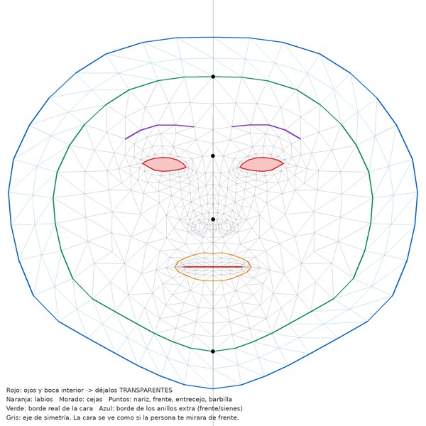
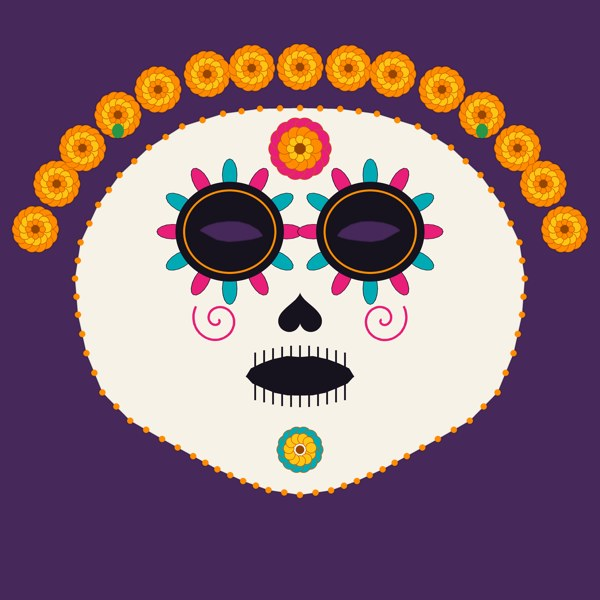

# Guía: pintar la textura de la máscara

La máscara es una sola imagen PNG de **2048 × 2048 con transparencia** que se pega sobre la malla facial de MediaPipe usando su mapa UV. Todo lo que pintes en una zona de la plantilla queda pegado a esa parte de la cara (ojos, nariz, boca, contorno) y se deforma con los gestos.

Archivo final: **`assets/mascara/textura.png`** (reemplaza al provisional).

 

## Qué significa cada color de la plantilla

| Color | Zona |
| --- | --- |
| Rojo (relleno) | Ojos y boca interior. **Déjalos transparentes.** La malla ya no tiene triángulos ahí, pero conviene no pintarlos. |
| Naranja | Contorno exterior de los labios. |
| Morado | Cejas. |
| Puntos negros | Frente, entrecejo, punta de la nariz y barbilla. |
| Verde | Borde real de la cara. |
| Azul / zona azul clara | Dos anillos extra que cubren la parte alta de la frente y las sienes (ideal para una corona de cempasúchil). Lo que dejes transparente ahí no se ve. |
| Línea gris | Eje de simetría. |

La plantilla se ve como si la persona te mirara de frente: su lado derecho queda a tu izquierda.

## Opción A: pintar directo en Blender (Texture Paint)

1. Abre `blender/mascara_dia_de_muertos.blend`.
   - Si no existe o quieres empezar de cero, en Blender ve a **Scripting → Open → `tools/preparar_blender.py` → Run Script** (o en terminal: `blender --background --python tools/preparar_blender.py`).
2. Cambia a la pestaña **Texture Paint**. La malla ya trae:
   - la imagen `textura` (archivo `blender/textura.png`, transparente) como lienzo activo;
   - la plantilla debajo como guía (no se pinta en la textura);
   - simetría en **X** activada: pinta media cara y se refleja sola.
3. Pinta con colores saturados y contornos definidos (el detalle fino se pierde en la cámara). Ideas: calavera con base hueso, cuencas oscuras con pétalos, nariz de corazón invertido, boca cosida, cempasúchil en la frente, papel picado o espirales en las mejillas.
4. Para borrar a transparente usa el pincel en modo **Erase Alpha** (Brush → Blend: Erase Alpha).
5. Guarda la imagen: en el editor de imagen **Image → Save** (Alt + S). Se escribe en `blender/textura.png`.
6. Copia ese archivo como `assets/mascara/textura.png` y recarga el filtro.

> Paso 2 de la rúbrica (UV Editor → Export UV Layout): con la malla seleccionada, entra a **UV Editing**, selecciona todo (A) y usa **UV → Export UV Layout** a 2048 px. El script también lo intenta y lo guarda como `blender/plantilla_uv_blender.png` cuando se ejecuta con la ventana abierta. La plantilla `plantilla/plantilla_uv.png` es la misma, con las zonas marcadas.

## Opción B: pintar en Krita, Photoshop o Procreate

1. Abre `plantilla/plantilla_uv.png` (2048 × 2048).
2. Agrega una capa encima y pinta ahí, siguiendo las marcas.
3. Oculta la plantilla y exporta **solo tu capa** como PNG con transparencia.
4. Guárdala como `assets/mascara/textura.png`.

`plantilla/plantilla_uv_transparente.png` sirve si prefieres poner la guía como capa superior semitransparente.

## Revisar y corregir

- Abre el filtro con `?debug`: muestra el giro de la cabeza para probar perfiles.
- Prueba en varias caras y con la boca abierta. Si algo queda corrido, corrígelo en la plantilla y vuelve a exportar.
- Evita que el color llegue justo al borde verde si no quieres que se vea el corte; un borde decorativo (puntos, flores) disimula la orilla.
- No muevas los vértices ni las UVs en Blender: la app usa exactamente estas UVs.

## Si cambias la malla

Las plantillas, `blender/cara_base.obj` y `js/datos-cara.js` salen de `tools/generar_datos_cara.py` (requiere Python 3 y Pillow). Si cambias los anillos o quieres otra resolución, ejecuta:

```bash
python3 tools/generar_datos_cara.py
python3 tools/generar_textura_provisional.py   # opcional, textura de prueba
```
